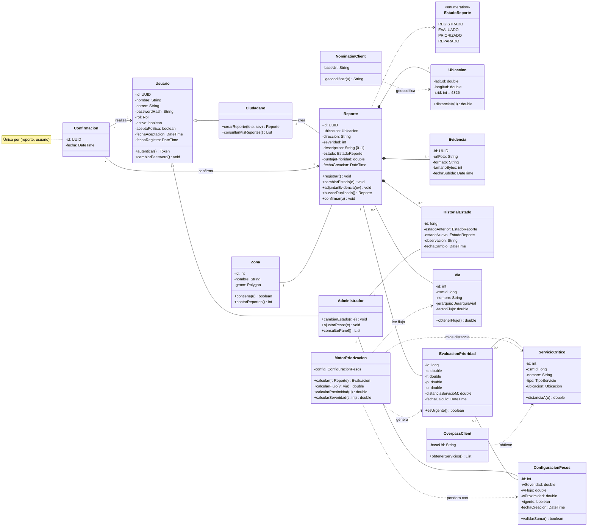

# Diagrama de clases UML

Fuente canónica del modelo de dominio desde el 2026-11-23. Es la versión en Mermaid del diagrama de
clases de Lucid («Street Repo - Diagrama de Clases UML», última edición del 2026-10-15), con su
mismo contenido. Las diferencias con el código actual están en la sección final y no se aplicaron
al diagrama (protocolo 0.3 de `AGENTS.md`).

## Diferencias conocidas con el código (pendientes de decisión)

El diagrama conserva el diseño de la tesis. El código evolucionó con decisiones registradas en la
bitácora; estas diferencias se deben decidir antes de cambiar el diagrama:

- **Objetivo 4 (decisión 115):** faltan `RondaEvaluacion`, `ReporteDeRonda`, `OrdenEvaluador`,
  `AvisoDuplicado` y el rol `Evaluador`; `Zona` no tiene `concentracion`.
- **Autenticación y titular (propuestas 8 a 10):** faltan `TokenRefresco`, `SolicitudSupresion` y
  `Usuario.versionPolitica`.
- **Confirmación (propuesta 112):** falta `Confirmacion.distanciaM`.
- **Arquitectura:** el código separa el dominio en módulos con casos de uso y repositorios
  (sección 4 de `AGENTS.md`); el motor está dividido en reglas por factor (`FactorRules`) y
  `ReportEvaluator`. Nominatim y Overpass no se consultan en tiempo de ejecución: los datos de OSM se
  cargan con `osm-import` (sección 3.1).
