# Diagrama de clases UML

Fuente canónica del modelo de dominio. Refleja el código del backend en
`backend/app/modules/*/domain` y `application` al 2026-11-23 (fila 130 de la bitácora). Los nombres
son los del código (inglés, sección 9.1 de `AGENTS.md`); la equivalencia con las tablas está en
[`docs/base-de-datos.md`](../base-de-datos.md).

El dominio usa objetos de valor inmutables (`@dataclass(frozen=True)`) y funciones puras; la
persistencia queda detrás de puertos (`Protocol`) que implementa la capa `infrastructure`. Por eso
el diagrama se divide en dos vistas:

1. **Modelo de dominio:** entidades, objetos de valor y enumeraciones.
2. **Priorización y casos de uso:** el motor U, quién lo usa y de qué puertos depende.

## 1. Modelo de dominio

```mermaid
classDiagram
    direction LR

    class UserRole {
        <<enumeration>>
        CITIZEN
        ADMIN
        EVALUATOR
    }
    class User {
        +id: UUID
        +name: str
        +email: str
        +password_hash: str
        +role: UserRole
        +is_active: bool
        +consent: PolicyConsent [0..1]
        +registered_at: datetime
    }
    class PolicyConsent {
        +version: str
        +accepted_at: datetime
    }
    class DeletionRequest {
        +id: UUID
        +user_id: UUID
        +status: DeletionRequestStatus
        +requested_at: datetime
        +attended_at: datetime [0..1]
    }
    class StoredRefreshToken {
        +id: UUID
        +user_id: UUID
        +expires_at: datetime
        +revoked: bool
        +replaced_by: UUID [0..1]
    }

    class GeoPoint {
        +longitude: float
        +latitude: float
    }
    class Severity {
        <<enumeration>>
        LOW = 1
        MEDIUM = 2
        HIGH = 3
    }
    class ReportStatus {
        <<enumeration>>
        REGISTERED
        EVALUATED
        PRIORITIZED
        REPAIRED
    }
    class NewReport {
        +user_id: UUID
        +location: GeoPoint
        +severity: Severity
        +description: str [0..1]
        +idempotency_key: UUID [0..1]
    }
    class ReportDetails {
        +id: UUID
        +user_id: UUID
        +location: GeoPoint
        +severity: Severity
        +description: str [0..1]
        +status: ReportStatus
        +priority_score: Decimal [0..1]
        +road_id: int [0..1]
        +road_name: str [0..1]
        +created_at: datetime
    }
    class StoredEvidence {
        +photo_key: str
        +file_format: str
        +size_bytes: int
    }
    class StatusChange {
        +previous: ReportStatus [0..1]
        +new: ReportStatus
        +changed_by: UUID [0..1]
        +note: str [0..1]
    }
    class status_machine {
        <<module>>
        +allowed_next_statuses(current) tuple
        +initial_status_change(created_by) StatusChange
        +change_status(current, new, changed_by, note) StatusChange
    }
    class DuplicateCandidate {
        +id: UUID
        +location: GeoPoint
        +distance_m: float
        +status: ReportStatus
        +confirmations: int
        +is_mine: bool
    }
    class ConfirmationTarget {
        +owner_id: UUID
        +status: ReportStatus
        +distance_m: float
    }

    class RoadClass {
        <<enumeration>>
        PRIMARY
        SECONDARY
        TERTIARY
        RESIDENTIAL
    }
    class RoadMatch {
        +road_id: int
        +name: str [0..1]
        +road_class: RoadClass
        +flow_factor: Decimal
        +distance_m: float
    }
    class CriticalServiceType {
        <<enumeration>>
        HOSPITAL
        SCHOOL
    }
    class NearestCriticalService {
        +service_id: int
        +name: str [0..1]
        +service_type: CriticalServiceType
        +distance_m: float
    }

    class Weights {
        +severity: Decimal
        +flow: Decimal
        +proximity: Decimal
    }
    class WeightVersion {
        +id: int
        +weights: Weights
        +created_by: UUID [0..1]
        +created_at: datetime
        +is_current: bool
    }
    class UrgencyEvaluation {
        +severity_score: Decimal
        +flow_score: Decimal
        +proximity_score: Decimal
        +urgency_score: Decimal
        +weights: Weights
        +road_id: int [0..1]
        +service_id: int [0..1]
        +service_distance_m: Decimal [0..1]
        +needs_road_review() bool
    }

    class Concentration {
        <<enumeration>>
        HIGH
        LOW
    }
    class ZoneDefinition {
        +name: str
        +concentration: Concentration
        +polygon_geojson: dict
    }
    class RoundStatus {
        <<enumeration>>
        OPEN
        CLOSED
    }
    class RoundSummary {
        +round_id: UUID
        +name: str
        +status: RoundStatus
        +sample_size: int
        +opened_at: datetime
        +closed_at: datetime [0..1]
    }
    class RoundEntry {
        +report_id: UUID
        +zone_id: int
        +urgency_score: Decimal
        +motor_order: int
    }
    class BlindCard {
        +report_id: UUID
        +description: str [0..1]
        +road_name: str [0..1]
        +severity: Severity
        +location: GeoPoint
    }
    class WarningDecision {
        <<enumeration>>
        PENDING
        CONFIRMED
        CREATED_ANYWAY
    }
    class ZoneAgreement {
        +zone_id: int
        +n_reports: int
        +n_evaluators: int
        +spearman: Correlation [0..1]
        +kendall: Correlation [0..1]
        +kendall_w: KendallW [0..1]
        +within_one_pct: float
    }

    User --> UserRole
    User *-- "0..1" PolicyConsent
    User "1" -- "0..*" DeletionRequest : solicita
    User "1" -- "0..*" StoredRefreshToken : sesiones
    NewReport --> GeoPoint
    NewReport --> Severity
    ReportDetails --> ReportStatus
    ReportDetails "1" *-- "1" StoredEvidence : foto
    ReportDetails "1" -- "1..*" StatusChange : historial
    status_machine ..> StatusChange : crea
    status_machine ..> ReportStatus : valida transiciones
    DuplicateCandidate ..> ReportDetails : reporte a 25 m o menos
    ConfirmationTarget ..> ReportDetails : confirmar a 50 m o menos
    RoadMatch --> RoadClass
    NearestCriticalService --> CriticalServiceType
    WeightVersion *-- Weights
    UrgencyEvaluation --> Weights
    UrgencyEvaluation ..> RoadMatch : F
    UrgencyEvaluation ..> NearestCriticalService : P
    ZoneDefinition --> Concentration
    RoundSummary --> RoundStatus
    RoundSummary "1" *-- "1..*" RoundEntry : muestra congelada
    RoundEntry ..> BlindCard : vista a ciegas
    BlindCard --> Severity
    ZoneAgreement ..> RoundEntry : orden del motor vs. panel
```

`Correlation` y `KendallW` guardan coeficiente y valor p; `DeletionRequestStatus` es `PENDING` o
`ATTENDED`. Los avisos de duplicado (`WarningDecision`) se registran con el puerto
`DuplicateWarningRecorder` al confirmar o al crear de todos modos.

## 2. Priorización y casos de uso

```mermaid
classDiagram
    direction TB

    class FactorRules {
        <<Strategy>>
        +severity(Severity) Decimal
        +flow(RoadMatch) Decimal
        +proximity(Decimal) Decimal
    }
    class PriorityModel {
        -weights: Weights
        -rules: FactorRules
        +evaluate(EvaluationInput) UrgencyEvaluation
    }
    class EvaluationInput {
        +severity: Severity
        +road: RoadMatch [0..1]
        +nearest_service: NearestCriticalService [0..1]
    }
    class ranking {
        <<module>>
        +ranking_key(item) tuple
        +rank(items) list
    }
    class ReportEvaluator {
        +evaluate(report_id) UrgencyEvaluation
        +evaluate_with(report, version) UrgencyEvaluation
    }

    class CreateReport {
        <<use case>>
    }
    class FindPossibleDuplicates {
        <<use case>>
    }
    class ConfirmReport {
        <<use case>>
    }
    class ChangeReportStatus {
        <<use case>>
    }
    class UpdateWeights {
        <<use case>>
    }
    class ImportOsmData {
        <<use case>>
    }
    class OpenRound {
        <<use case>>
    }
    class SubmitOrder {
        <<use case>>
    }
    class RoundResultsService {
        <<use case>>
    }

    class RoadMatcher {
        <<interface>>
    }
    class CriticalServiceLocator {
        <<interface>>
    }
    class WeightVersionRepository {
        <<interface>>
    }
    class EvaluationRepository {
        <<interface>>
    }
    class ReportRepository {
        <<interface>>
    }
    class NearbyReportFinder {
        <<interface>>
    }
    class PhotoProcessor {
        <<interface>>
    }
    class PhotoStorage {
        <<interface>>
    }
    class StatusHistoryRecorder {
        <<interface>>
    }
    class ConfirmationRepository {
        <<interface>>
    }
    class OsmDataSource {
        <<interface>>
    }
    class RoundRepository {
        <<interface>>
    }
    class BlindEvaluationRepository {
        <<interface>>
    }
    class TransactionManager {
        <<interface>>
    }
    class PriorityEvaluator {
        <<interface>>
    }
    class DuplicateWarningRecorder {
        <<interface>>
    }
    class ReportStatusLock {
        <<interface>>
    }
    class RoundResultsReader {
        <<interface>>
    }

    PriorityModel o-- FactorRules
    PriorityModel ..> EvaluationInput
    ReportEvaluator ..> PriorityModel : U = w1·S + w2·F + w3·P
    ReportEvaluator --> RoadMatcher : vía a 30 m o menos
    ReportEvaluator --> CriticalServiceLocator : servicio más cercano
    ReportEvaluator --> WeightVersionRepository : pesos vigentes
    ReportEvaluator --> EvaluationRepository : guarda la evaluación

    CreateReport --> PhotoProcessor : valida, quita EXIF, miniatura
    CreateReport --> PhotoStorage
    CreateReport --> NearbyReportFinder : posible duplicado
    CreateReport --> ReportRepository
    CreateReport --> StatusHistoryRecorder
    CreateReport --> PriorityEvaluator : Registrado → Evaluado
    CreateReport --> DuplicateWarningRecorder
    PriorityEvaluator <|.. ReportEvaluator
    CreateReport --> TransactionManager
    FindPossibleDuplicates --> NearbyReportFinder
    ConfirmReport --> ConfirmationRepository
    ConfirmReport --> DuplicateWarningRecorder
    ChangeReportStatus --> StatusHistoryRecorder
    ChangeReportStatus --> ReportStatusLock
    UpdateWeights --> WeightVersionRepository : versión nueva
    UpdateWeights --> ReportEvaluator : recalcula reportes activos
    ImportOsmData --> OsmDataSource : Overpass, carga idempotente
    OpenRound --> RoundRepository : muestra y orden del motor
    OpenRound --> WeightVersionRepository : congela pesos
    OpenRound ..> ranking : sample_and_rank
    SubmitOrder --> BlindEvaluationRepository
    RoundResultsService --> RoundResultsReader : Spearman, Kendall, W
```

Notas:

- `ReportEvaluator` no confirma la transacción; la controla el caso de uso que lo llama
  (`CreateReport` o `UpdateWeights`, sección 4.5 de `AGENTS.md`).
- `ChangeReportStatus` usa `status_machine.change_status`: avances con salto permitidos, retrocesos
  prohibidos y Registrado → Evaluado solo por el motor (sección 2.4).
- El orden del ranking (`ranking.rank`) es U, luego severidad, confirmaciones y antigüedad; la
  consulta SQL del panel lo reproduce.
- Los puertos se implementan en `infrastructure/` con SQLAlchemy + PostGIS, Pillow (fotos), disco
  local (`LocalPhotoStorage`) y HTTP a Overpass solo para `osm-import`.
