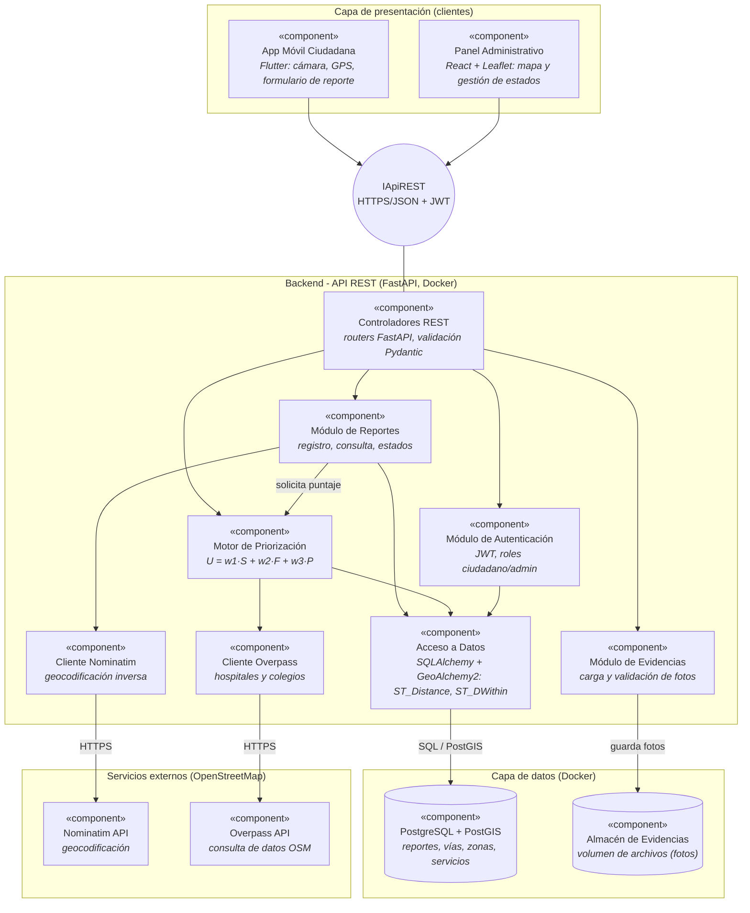

# Diagrama de componentes UML

Fuente canónica desde el 2026-11-23. Es la versión en Mermaid del diagrama de componentes de Lucid
(«Street Repo - Diagrama de Componentes UML», última edición del 2026-10-15), con su mismo
contenido. Las diferencias con el sistema construido están en la sección final.

## Diferencias conocidas con el sistema construido (pendientes de decisión)

- El backend es un monolito modular con módulos `auth`, `users`, `reports`, `confirmations`,
  `priority`, `roads`, `critical_services`, `admin` y `validation` (zonas, rondas y avisos del
  objetivo 4), cada uno con capas `presentation / application / domain / infrastructure`.
- Nominatim y Overpass no se llaman en tiempo de ejecución: la carga de OSM es un comando aparte
  (`osm-import`) que guarda vías y servicios en PostGIS (sección 3.1 de `AGENTS.md`); la dirección
  del reporte es el nombre de la vía (propuesta 41).
- Existe una tercera interfaz cliente: la página de presentación (`landing/`, en Vercel, decisión 99).
