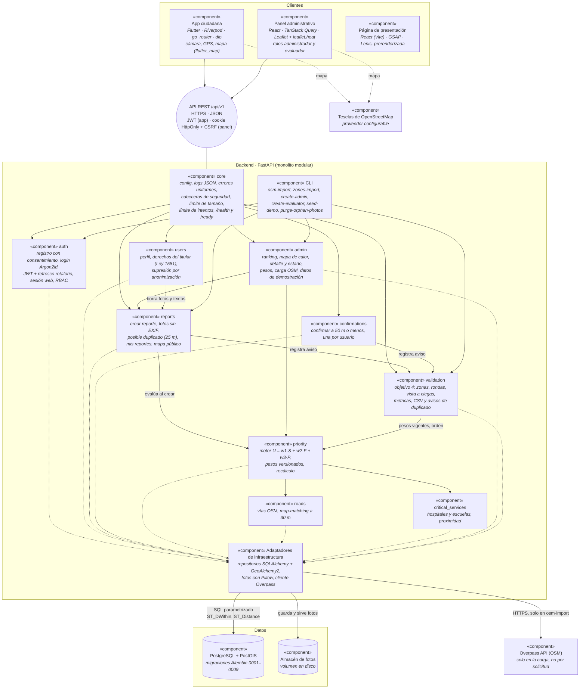

# Diagrama de componentes UML

Fuente canónica de la arquitectura. Refleja lo construido al 2026-11-23 (fila 130 de la bitácora):
un monolito modular en FastAPI con capas `presentation → application → domain ← infrastructure`
(sección 4 de `AGENTS.md`), dos clientes y la página de presentación.

Notas:

- Cada módulo del backend tiene las capas `presentation / application / domain / infrastructure`;
  el dominio no importa FastAPI ni SQL y define sus puertos (ver [`clases.md`](clases.md)). Las
  flechas entre módulos son dependencias a través de esos puertos, y cada módulo tiene sus propios
  adaptadores en `infrastructure/` (aquí agrupados en un solo nodo).
- Nominatim no se usa en el MVP: la dirección del reporte es el nombre de la vía asociada
  (propuesta 41). Overpass solo se consulta al cargar los datos de OSM (sección 3.1).
- La página de presentación no consume la API: solo ofrece la descarga de la app (decisión 99).
