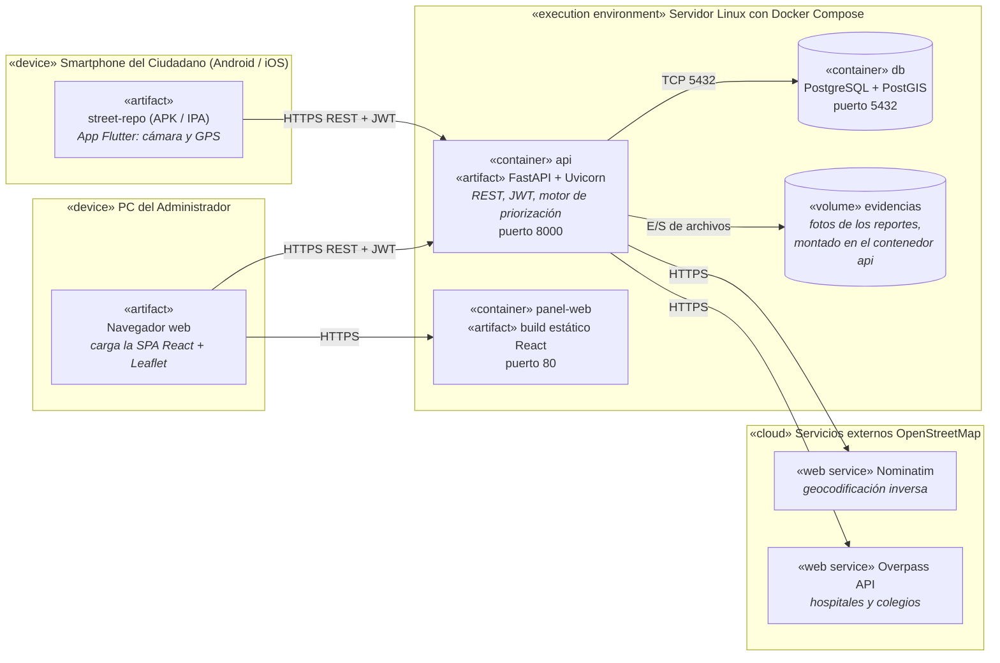

# Diagrama de despliegue UML

Fuente canónica desde el 2026-11-23. Es la versión en Mermaid del diagrama de despliegue de Lucid
(«Street Repo - Diagrama de Despliegue UML», última edición del 2026-10-15), con su mismo contenido.
Las diferencias con el despliegue actual están en la sección final.

## Diferencias conocidas con el despliegue actual (pendientes de decisión)

- Delante de la API y del panel hay un proxy HTTPS con Caddy (HU-17, fila 121 de la bitácora); el
  despliegue en servidor está pospuesto y la app se prueba contra el backend local (fila 123).
- En `infra/docker-compose.yml` el panel es el servicio `admin-web` (nginx sin root), el volumen de
  fotos se llama `photos` y un servicio `migrate` aplica las migraciones antes de la API.
- La API no llama a Nominatim ni a Overpass por cada solicitud: `osm-import` carga los datos de OSM
  a PostGIS (sección 3.1 de `AGENTS.md`).
- La página de presentación (`landing/`) se despliega en Vercel, fuera del servidor (decisión 99).
