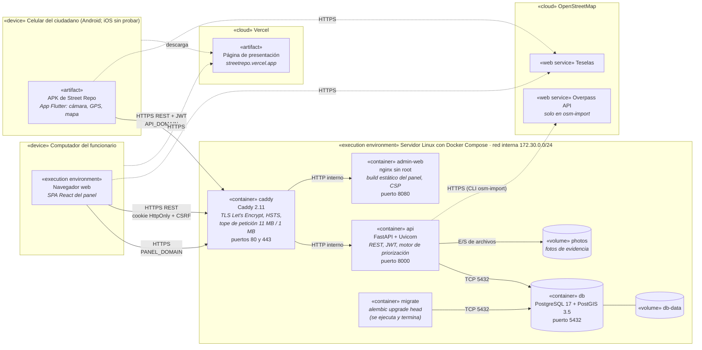

# Diagrama de despliegue UML

Fuente canónica del despliegue. Refleja `infra/docker-compose.yml` más
`infra/docker-compose.prod.yml` (HTTPS con Caddy, HU-17) y la página en Vercel, al 2026-11-23
(fila 130 de la bitácora). El despliegue en servidor está pospuesto (fila 123): hoy la app se prueba
en el celular contra el mismo Compose levantado en el computador del responsable.

Notas:

- En producción solo Caddy publica puertos; la base, la API y el panel quedan en la red interna, y
  la API solo cree `X-Forwarded-For` si viene de la IP fija de Caddy.
- En desarrollo (solo `docker-compose.yml`) no hay Caddy: la API se publica en el puerto 8000
  (`API_BIND_ADDRESS` permite exponerla en la red local para el celular) y el panel en el 8080.
- Los comandos de la CLI (`osm-import`, `zones-import`, `create-admin`, `create-evaluator`,
  `seed-demo`, `purge-orphan-photos`) se ejecutan dentro del contenedor `api`.
- La página de presentación se despliega aparte, en Vercel (decisión 99).
