# Diagrama entidad-relación (DER)

Fuente canónica del modelo de datos desde el 2026-11-23 (antes, el DER de Lucid; ver bitácora).
Refleja el esquema de las migraciones `0001` a `0009` de `backend/migrations/versions/`.
Nombres de tablas y columnas en español, como en la base de datos; el mapeo con el código está
en [`docs/base-de-datos.md`](../base-de-datos.md).

Convenciones: `PK` clave primaria, `FK` clave foránea, `UK` única. Los tipos con precisión
(`NUMERIC(p,s)`) y los valores de los `ENUM` van en el comentario porque la sintaxis de Mermaid no
admite comas dentro del tipo. «opcional» marca las columnas que admiten `NULL`.

```mermaid
erDiagram
    usuario {
        UUID id_usuario PK
        VARCHAR(100) nombre
        VARCHAR(150) correo UK
        VARCHAR(255) password_hash
        ENUM rol "ciudadano | administrador | evaluador"
        BOOLEAN activo
        BOOLEAN acepta_politica
        TIMESTAMPTZ fecha_aceptacion "opcional"
        VARCHAR(20) version_politica "opcional"
        TIMESTAMPTZ fecha_registro
    }

    token_refresco {
        UUID id_token PK
        UUID id_usuario FK
        VARCHAR(255) hash_token UK
        TIMESTAMPTZ emitido
        TIMESTAMPTZ expira
        BOOLEAN revocado
        UUID reemplazado_por FK "opcional"
    }

    solicitud_supresion {
        UUID id_solicitud PK
        UUID id_usuario FK
        ENUM estado "pendiente | atendida"
        TIMESTAMPTZ fecha_solicitud
        TIMESTAMPTZ fecha_atencion "opcional"
    }

    zona {
        SERIAL id_zona PK
        VARCHAR(100) nombre UK
        GEOMETRY geom "Polygon, 4326"
        ENUM concentracion "alta | baja"
    }

    via {
        SERIAL id_via PK
        BIGINT osm_id UK
        VARCHAR(150) nombre "opcional"
        ENUM jerarquia_vial "primaria | secundaria | terciaria | residencial"
        NUMERIC factor_flujo "(4,2), 0 a 10"
        GEOMETRY geom "LineString, 4326"
        VARCHAR(30) highway_osm
    }

    servicio_critico {
        SERIAL id_servicio PK
        BIGINT osm_id UK
        VARCHAR(150) nombre "opcional"
        ENUM tipo "hospital | escuela"
        GEOMETRY ubicacion "Point, 4326"
    }

    configuracion_pesos {
        SERIAL id_config PK
        UUID id_usuario FK "opcional: NULL = sistema"
        NUMERIC w_severidad "(3,2)"
        NUMERIC w_flujo "(3,2)"
        NUMERIC w_proximidad "(3,2); suma = 1,00"
        BOOLEAN vigente "una sola vigente"
        TIMESTAMPTZ fecha_creacion
    }

    reporte {
        UUID id_reporte PK
        UUID id_usuario FK
        INTEGER id_zona FK "opcional"
        INTEGER id_via FK "opcional: NULL = Revisar vía"
        GEOMETRY ubicacion "Point, 4326"
        VARCHAR(255) direccion "opcional"
        SMALLINT severidad "1 a 3"
        TEXT descripcion "opcional"
        ENUM estado "registrado | evaluado | priorizado | reparado"
        NUMERIC puntaje_prioridad "(4,2), opcional"
        TIMESTAMPTZ fecha_creacion
        UUID clave_idempotencia "opcional; UK con id_usuario"
    }

    evidencia {
        UUID id_evidencia PK
        UUID id_reporte FK
        VARCHAR(255) url_foto
        VARCHAR(10) formato
        INTEGER tamano_bytes
        TIMESTAMPTZ fecha_subida
    }

    confirmacion {
        UUID id_confirmacion PK
        UUID id_reporte FK "UK con id_usuario"
        UUID id_usuario FK
        TIMESTAMPTZ fecha
        NUMERIC distancia_m "(7,2), opcional"
    }

    historial_estado {
        BIGSERIAL id_historial PK
        UUID id_reporte FK
        UUID id_usuario FK "opcional: NULL = sistema"
        ENUM estado_anterior "opcional"
        ENUM estado_nuevo
        TEXT observacion "opcional"
        TIMESTAMPTZ fecha_cambio
    }

    evaluacion_prioridad {
        BIGSERIAL id_evaluacion PK
        UUID id_reporte FK
        INTEGER id_config FK
        INTEGER id_servicio FK "opcional"
        NUMERIC distancia_servicio_m "(8,2), opcional"
        NUMERIC s_severidad "(4,2)"
        NUMERIC f_flujo "(4,2)"
        NUMERIC p_proximidad "(4,2)"
        NUMERIC u_utilidad "(4,2)"
        TIMESTAMPTZ fecha_calculo
    }

    ronda_evaluacion {
        UUID id_ronda PK
        VARCHAR(100) nombre
        ENUM estado "abierta | cerrada; una sola abierta"
        SMALLINT tamano_muestra "mayor que 0"
        BIGINT semilla
        INTEGER id_config FK
        UUID id_usuario FK
        TIMESTAMPTZ fecha_apertura
        TIMESTAMPTZ fecha_cierre "opcional"
    }

    ronda_reporte {
        UUID id_ronda PK, FK
        UUID id_reporte PK, FK
        INTEGER id_zona FK
        NUMERIC puntaje_u "(4,2)"
        SMALLINT orden_motor "UK con id_ronda e id_zona"
    }

    orden_evaluador {
        UUID id_ronda PK, FK
        UUID id_usuario PK, FK
        UUID id_reporte PK, FK
        SMALLINT posicion
        TIMESTAMPTZ fecha_envio
    }

    aviso_duplicado {
        UUID id_aviso PK
        UUID id_usuario FK
        INTEGER id_zona FK "opcional"
        TIMESTAMPTZ fecha
        ENUM decision "pendiente | confirmo | creo_igual"
        UUID id_reporte_resultante FK "opcional"
    }

    aviso_duplicado_candidato {
        UUID id_aviso PK, FK
        UUID id_reporte PK, FK
        NUMERIC distancia_m "(6,2)"
    }

    usuario ||--o{ token_refresco : "tiene"
    token_refresco |o--o| token_refresco : "reemplazado por"
    usuario ||--o{ solicitud_supresion : "solicita"
    usuario |o--o{ configuracion_pesos : "guarda"
    usuario ||--o{ reporte : "crea"
    usuario ||--o{ confirmacion : "confirma"
    usuario |o--o{ historial_estado : "cambia"
    zona |o--o{ reporte : "contiene"
    via |o--o{ reporte : "asociada a"
    reporte ||--o{ evidencia : "tiene"
    reporte ||--o{ confirmacion : "recibe"
    reporte ||--o{ historial_estado : "registra"
    reporte ||--o{ evaluacion_prioridad : "se evalúa en"
    configuracion_pesos ||--o{ evaluacion_prioridad : "pondera"
    servicio_critico |o--o{ evaluacion_prioridad : "más cercano"

    configuracion_pesos ||--o{ ronda_evaluacion : "congela pesos de"
    usuario ||--o{ ronda_evaluacion : "abre"
    ronda_evaluacion ||--o{ ronda_reporte : "incluye"
    reporte ||--o{ ronda_reporte : "congelado en"
    zona ||--o{ ronda_reporte : "agrupa"
    ronda_reporte ||--o{ orden_evaluador : "ordenado por"
    usuario ||--o{ orden_evaluador : "evalúa"
    usuario ||--o{ aviso_duplicado : "recibe"
    zona |o--o{ aviso_duplicado : "ubica"
    reporte |o--o{ aviso_duplicado : "resulta de"
    aviso_duplicado ||--o{ aviso_duplicado_candidato : "muestra"
    reporte ||--o{ aviso_duplicado_candidato : "candidato en"
```

## Restricciones que no caben en el diagrama

- `usuario`: si `acepta_politica`, deben existir `fecha_aceptacion` y `version_politica`.
- `configuracion_pesos`: cada peso entre 0 y 1, suma exacta de 1,00 e índice único parcial para
  una sola fila `vigente`.
- `reporte`: `severidad` entre 1 y 3, `puntaje_prioridad` entre 0 y 10, única
  `(id_usuario, clave_idempotencia)`; índices GiST sobre `ubicacion` (geometry y geography).
- `confirmacion`: única `(id_reporte, id_usuario)`; `distancia_m >= 0` (NULL en las anteriores a
  la migración 0008).
- `solicitud_supresion`: una sola pendiente por usuario; `fecha_atencion` existe solo si está
  atendida.
- `token_refresco`: `expira > emitido`.
- `ronda_evaluacion`: una sola ronda `abierta` (índice único parcial); `tamano_muestra > 0`.
- `ronda_reporte`: única `(id_ronda, id_zona, orden_motor)`.
- `orden_evaluador`: `(id_ronda, id_reporte)` es FK compuesta a `ronda_reporte`.
